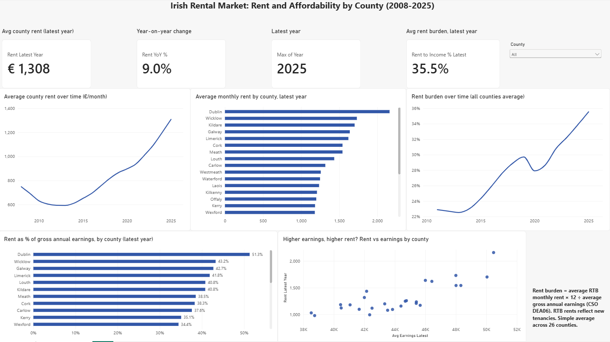

# Irish Rental Market: Rent and Affordability by County (2008-2025)

## Business question
How have rents changed across Irish counties since 2008, and where is rent least affordable relative to earnings?

## Key findings
- Average county rent reached €1,308 per month in 2025, up 9.0% year on year.
- Average rent burden (annual rent as a share of gross annual earnings) rose from about 23% in 2011 to 35.5% in 2025.
- Dublin had the highest rent burden at 51.3%, followed by Wicklow (43.2%) and Galway (42.7%).
- [Add one more finding from your own look at the charts]

## Data sources
- CSO PxStat RIA02: RTB Average Monthly Rent Report, by county, 2008-2025
- CSO PxStat DEA06: Annual Earnings by county, 2011-2025
- Raw rent CSV not included due to file size. Download from data.cso.ie, table RIA02.

## Method
- Cleaned in Power Query: filtered 62 locations (towns, cities, Dublin postal areas) down to 26 counties, removed overlapping bedroom bands and zero values (RTB's "insufficient data" flag).
- Built a star-style model with Counties and Years lookup tables linking Rent and Earnings.
- DAX measures for year-on-year change, latest-year values and rent-to-income ratio.

## Limitations
- Rent burden = average monthly rent x 12 / average gross annual earnings. It is an indicator, not a household-level figure.
- RTB rents reflect new tenancies, and county figures are simple averages, not population-weighted.

## Tools
Power BI, Power Query, DAX, Excel
